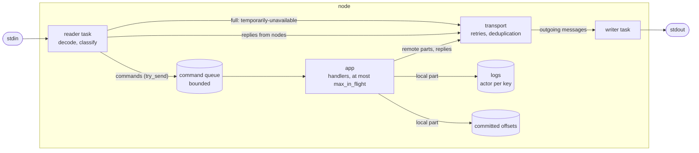
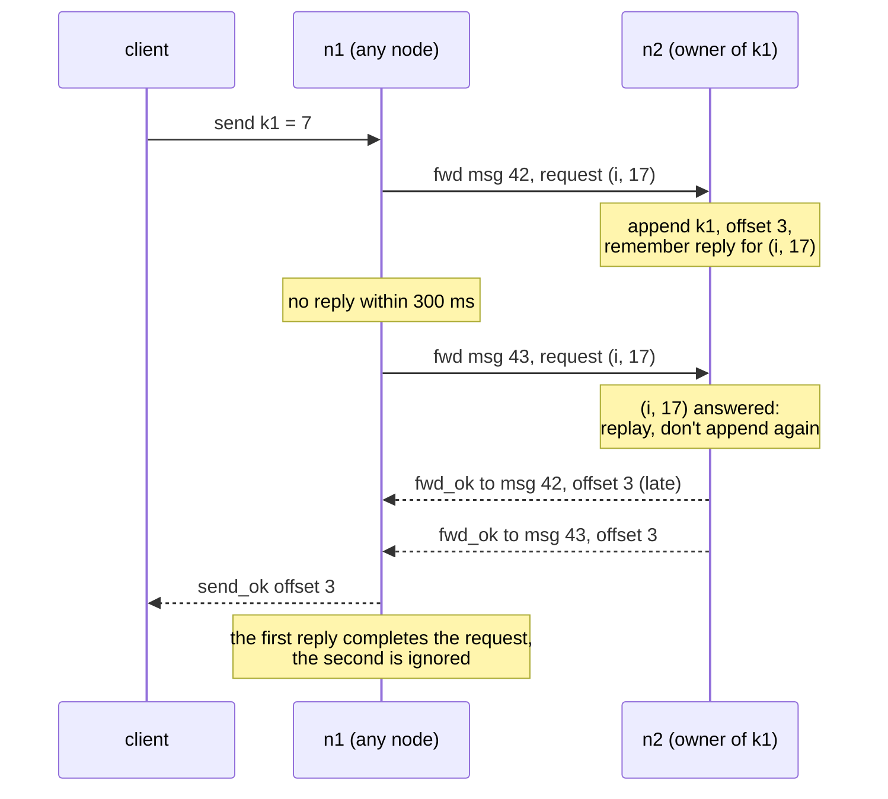
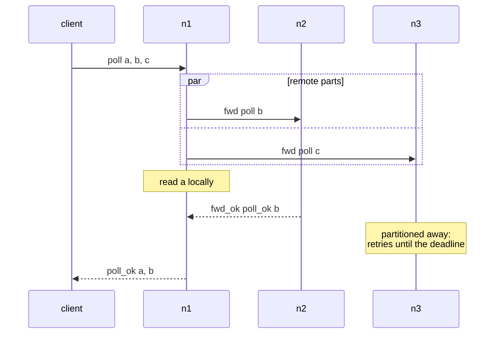

# Architecture

## Components

A node is three tasks connected by channels, plus one storage actor per key.



| Module | Responsibility |
|---|---|
| [`src/io`](../src/io/) | message I/O; production uses stdin/stdout |
| [`src/maelstrom/protocol`](../src/maelstrom/protocol/) | wire types, handshake, JSON and base64 value codecs |
| [`src/message`](../src/message/) | wire ⇄ application types, error codes |
| [`src/node.rs`](../src/node.rs) | task lifecycle, channels, dispatch, backpressure |
| [`src/app`](../src/app/) | request handling, ownership, fan-out to owners |
| [`src/transport`](../src/transport/) | outbound requests: retries, deadlines, pending replies, deduplication |
| [`src/logs`](../src/logs/) | segmented in-memory log storage |
| [`src/offsets`](../src/offsets/) | committed offsets |

- **The reader never waits for the app.** Commands go to a bounded queue with `try_send`;
  when it is full the request is rejected as `temporarily-unavailable` and the reader moves
  on. Replies from other nodes therefore always get through, even under overload.
- **Cancellation.** All tasks observe one `CancellationToken`. Forwards of a request are owned
  by its handler and aborted with it; there are no detached tasks.

## Ownership

Every key has exactly one owner, chosen by rendezvous (highest random weight) hashing:

```
owner(key) = argmax over nodes n of wyhash(n, wyhash(key, seed))
```

- Every node computes the same owner from the node list of the Maelstrom `init`, with no
  coordination.
- Adding or removing a node moves only the keys that end up on, or were on, that node.
- The owner stores the key's log and its committed offset.

Code: [`src/app/ownership.rs`](../src/app/ownership.rs).

## Forwarding a request

A request for a key owned by another node is forwarded over the
[internode protocol](internode-protocol.md). Retries carry the same `request_id`, so the
owner executes the request once:



## Multi-key requests

`poll`, `commit_offsets` and `list_committed_offsets` are split by owner. Remote parts are
forwarded concurrently and the local part runs meanwhile; then the results are merged.



How each operation treats a failed owner is in [errors](errors.md#per-operation).

## Storage

- **Logs.** One actor per key is the single writer: it assigns offsets and appends.
  Readers never lock: sealed segments are immutable and published with `ArcSwap` (RCU), the
  active segment is an append-only lock-free vector.
- **Committed offsets.** A sharded `DashMap`; an update keeps the maximum, so an offset never
  moves back.
- **Messages are opaque bytes.** The client's JSON value is converted only at the protocol
  edge; nodes pass bytes to each other as base64.

Everything is in memory: a node that stops loses its keys.
